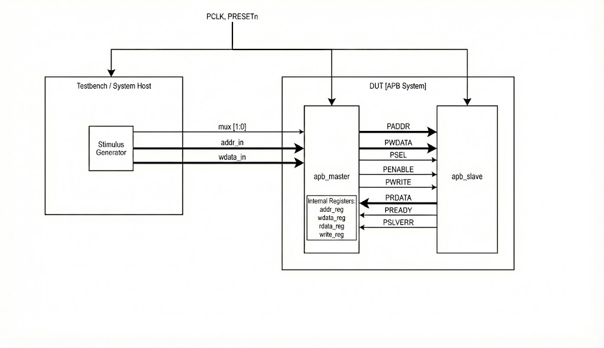
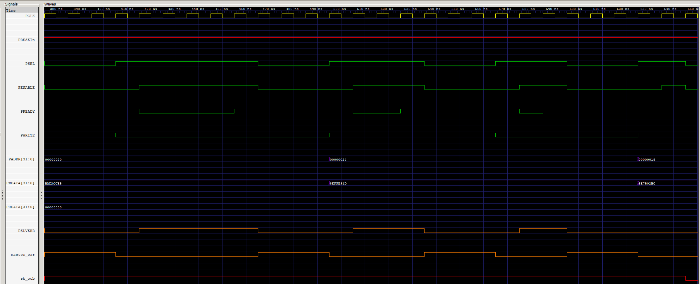

# FSM-Based AMBA APB Master & Slave Interface

## 1. Introduction
This project implements a robust **AMBA APB (Advanced Peripheral Bus)** Master and Slave communication system using SystemVerilog. The design focuses on a low-power, low-bandwidth control interface suitable for configuring registers in System-on-Chip (SoC) designs.

The core logic is driven by a **Finite State Machine (FSM)** that strictly adheres to the APB protocol phases (IDLE, SETUP, ACCESS), ensuring clean timing and reliable data transfer between the system controller and peripheral devices.

## 2. Key Features
* **FSM-Based Control:** The Master utilizes a dedicated 3-state FSM to manage bus timing and handshake signals automatically.
* **Configurable Transactions:** Supports both **Read** and **Write** operations triggered by a simple 2-bit multiplexer control signal.
* **Randomized Wait-States:** The included Slave module implements randomized wait-states (`PREADY` toggling) to verify the Master's ability to handle bus stalls correctly.
* **Parametrized Architecture:** Fully configurable `ADDR_WIDTH` and `DATA_WIDTH` (default 32-bit) via module parameters for flexible integration.
* **Enhanced Verification:** Includes **SystemVerilog Assertions (SVA)** for protocol compliance and **Functional Coverage** metrics.
* **Synchronous Design:** All internal registers and state transitions are synchronized to the rising edge of `PCLK`, with asynchronous active-low reset.

## 3. Architecture Overview
The system is divided into two main modules connected via the standard APB interface signals.

### Block Diagram


### 3.1 APB Master (Controller)
The Master acts as the bridge between the high-level system logic and the APB bus. It translates simple commands into the precise APB protocol timing:
1.  **IDLE State:** Waits for a transaction request (`mux` input).
2.  **SETUP Phase:** Drives the Address (`PADDR`) and Selection (`PSEL`) signals. This phase lasts exactly one clock cycle.
3.  **ACCESS Phase:** Asserts `PENABLE` to validate the transfer. It waits for the Slave's `PREADY` signal before completing the transaction and latching data (for reads) or finishing the write.

### 3.2 APB Slave (Peripheral)
The Slave implements a simple register file (`NUM_REGS` words, default 4) with dynamic timing:
* **Write Operations:** Data is written to the internal register array on the rising edge of `PCLK` when `PSEL`, `PENABLE`, `PWRITE`, and `PREADY` are active and the address is in range.
* **Wait-State Generation:** The Slave uses a random generator to deassert `PREADY`, simulating realistic peripheral delays.
* **Error Response:** `PSLVERR` is raised for an out-of-range address (decode error). The Master latches it at the handshake.

## 4. Interface Description
The module interacts with the host system on one side and the APB bus on the other. All operations are synchronized to the rising edge of the clock.

| Signal Group | Signal Name | Direction | Width | Description |
| :--- | :--- | :--- | :--- | :--- |
| **Global** | `PCLK` | Input | 1-bit | **System Clock**. All logic triggers on the rising edge. |
| | `PRESETn` | Input | 1-bit | **Active-Low Reset**. Asynchronous reset to initialize FSM and registers. |
| **System Interface** | `mux` | Input | 2-bit | **Operation Select**. Controls the transaction type:<br>`00`: IDLE (No op)<br>`01`: READ transaction<br>`11`: WRITE transaction<br>`10`: Ignored (stays IDLE) |
| | `addr_in` | Input | `ADDR_WIDTH` | **Address Input**. Target address provided by the system. |
| | `wdata_in` | Input | `DATA_WIDTH` | **Write Data Input**. Payload to be written to the slave (valid when `mux=11`). |
| | `master_err_out` | Output | 1-bit | **Transfer Error**. `PSLVERR` of the last completed transfer; cleared when a new transfer starts. |
| **APB Bus** | `PADDR` | Output | `ADDR_WIDTH` | **APB Address**. Driven to the peripheral during SETUP/ACCESS. |
| | `PSEL` | Output | 1-bit | **Slave Select**. Asserted to indicate a transaction start. |
| | `PENABLE` | Output | 1-bit | **Enable**. Asserted during the ACCESS phase to validate the transfer. |
| | `PWRITE` | Output | 1-bit | **Transfer Direction**. `1` = Write, `0` = Read. |
| | `PWDATA` | Output | `DATA_WIDTH` | **APB Write Data**. Driven by Master during write cycles. |
| | `PRDATA` | Input | `DATA_WIDTH` | **APB Read Data**. Incoming data from the Slave. |
| | `PREADY` | Input | 1-bit | **Ready Handshake**. Slave signal to extend the transfer (Wait states). |
| | `PSLVERR` | Input | 1-bit | **Slave Error**. Out-of-range address; latched by the Master at the handshake and reported on `master_err_out`. |

## 5. Verification
The system is verified using a self-checking testbench that includes a bus-level **Scoreboard** for data integrity, **SVA** assertions for protocol compliance, and **Functional Coverage** for test completeness (SVA and coverage run with `+define+APB_ASSERT` on a simulator that supports them).

### Functional Flow Verified:
1.  **Write Transaction:**
    * System sets `mux=11` and provides data/address.
    * Master FSM transitions `IDLE -> SETUP -> ACCESS`.
    * Slave detects write command and updates internal register at `addr_in`.
2.  **Read Transaction:**
    * System sets `mux=01`.
    * Master FSM transitions `IDLE -> SETUP -> ACCESS`.
    * Slave drives data from the requested register onto `PRDATA`.
    * Master latches `PRDATA` into internal `rdata_reg` when `PREADY` is high.

### Error Tests, Results and Fault Injection
* **Directed and error tests:** write/read of two registers, a write to the last valid register, and an out-of-range write and read (the Master must report an error).
* **Randomized test:** 200 write/read iterations, about 10% of them out of range.
* **SVA:** six protocol assertions in the Master (`PENABLE` needs `PSEL`, SETUP lasts one cycle, `PENABLE` rises right after SETUP, stable controls during wait-states, `PSEL` drops after the handshake, error latched at the handshake) and one decode-error assertion in the testbench.
* **Functional coverage:** direction, in/out of range, number of wait-states (0, 1, 2-3, 4+), error flag and register index, with crosses of direction x range and direction x wait-states.

| Run | Tool | Result |
| :--- | :--- | :--- |
| Clean, no SVA | Icarus Verilog | PASSED, 407 scoreboard checks |
| Clean, `+define+APB_ASSERT` | Cadence Xcelium (EDA Playground) | PASSED, 407 scoreboard checks, no SVA failures, functional coverage 100% |

Coverage is measured on the bins above, with the default seed.

**Fault injection** (compile-time switches that insert a known bug, to check that the verification catches it):

| Switch | Bug | Caught by |
| :--- | :--- | :--- |
| `INJECT_BUG` (Slave) | Write data has bit 0 flipped | Scoreboard and data checks (Icarus: 382 errors) |
| `INJECT_SVA_BUG2` (Master) | `PWDATA` changes while waiting for `PREADY` | `a_wait_state_stable` only; the scoreboard does not see it because the correct data is present at the handshake |
| `INJECT_SVA_BUG1` (Master) | `PENABLE` raised already in SETUP | `a_enable_after_setup` (first failure at 75 ns), `a_idle_after_done`, `a_err_latched` and `a_decode_err`; the testbench also reports data errors |

The testbench `STATUS` line counts only its own checks; with SVA enabled, look for `[SVA]` messages in the log.

### Simulation Waveform
The waveform below (about 380-650 ns of the simulation, viewed in GTKWave) shows the decode-error behavior with `NUM_REGS_TEST = 8`, i.e. valid addresses `0x00`-`0x1C`:



**Analysis of Results:**

1.  **Out-of-range read (`0x20`, directed test):** `PSLVERR` is raised, `PRDATA` stays `0`, and `master_err` goes high at the end of the transfer.
2.  **Out-of-range write and read (`0x24`, random stage):** the same behavior, with a different number of wait-states in each transfer. While `PREADY` is low, `PSEL`, `PENABLE`, `PADDR`, `PWRITE` and `PWDATA` stay stable.
3.  **In-range write (`0x18`, data `0x5E7502BC`):** no error, `master_err` stays low.

`PSLVERR` is asserted for the whole ACCESS phase of an out-of-range access. The Master samples it only at the handshake (`PSEL && PENABLE && PREADY`), as the protocol requires, and holds it in `master_err_out` until the next transfer starts.

## 6. File Description
* `RTL/APB_master.sv`: The FSM-based Master controller RTL (module `apb_master`) with SVA properties.
* `RTL/APB_slave.sv`: A reference Slave module (module `apb_slave_simple`) with randomized wait-states.
* `TB/TB_APB_system.sv`: Top-level testbench with Scoreboard and Coverage.
* `results/`: Simulation logs of the runs listed in Section 5.

## 7. Tools Used
* **Language:** SystemVerilog (IEEE 1800-2012)
* **Simulation:** Icarus Verilog (iverilog) for the basic run; Cadence Xcelium (EDA Playground) for SVA and functional coverage
* **Waveform Analysis:** GTKWave

## 8. How to Run Simulation
To compile and simulate the design using Icarus Verilog:

```bash
# 1. Compile the design (Note the folder paths)
iverilog -g2012 -o apb_sim RTL/APB_master.sv RTL/APB_slave.sv TB/TB_APB_system.sv

# 2. Run the simulation
vvp apb_sim

# 3. View Waveforms
gtkwave apb_final.vcd
```

To run the SVA and the functional coverage (commercial simulator, e.g. Xcelium):

```bash
xrun -sv -access +rw +define+APB_ASSERT -coverage functional \
     RTL/APB_master.sv RTL/APB_slave.sv TB/TB_APB_system.sv
```

Fault injection: add `-DINJECT_BUG` (Icarus), or `+define+INJECT_SVA_BUG1` / `+define+INJECT_SVA_BUG2` next to `+define+APB_ASSERT` (Xcelium).